# 遨游太阳系 · 真实度终局评估与实施方案

> **文档性质**：缺口全量清点 + 结论 + 可落地实施路线
> **基准版本**：工作区 `85e7f53` 之后的未提交候选（v2.2.0）
> **日期**：2026-10-15
> **对应目标**：*"完美逼真，1:1 模拟整个太阳系，让用户身临其境，达到无法区分真实与模拟的程度"*

---

## 阅读指引

本文分三层，可各取所需：

| 你关心什么 | 读哪几章 |
|---|---|
| 一句话结论、还差什么、先做什么 | 摘要 → 第 1 章 → 第 4 章 → 第 8 章 |
| 每一项缺口的具体证据 | 第 3 章 + 附录 A |
| 怎么实施、验收怎么算通过 | 第 5、6、7 章 |

全文引用的代码位置一律写成 `文件:行号`，可直接跳转核对。所有数字都可以用仓库内的脚本复现（见附录 C）。

---

## 摘要（结论先行）

### 一句话结论

> **当前项目在"位置对不对"上已经达到工程可信（行星 ≤0.074°，与 JPL 逐点吻合），但在"看得见的东西像不像"和"动起来对不对"上，距离"无法区分真实与模拟"还有 2–3 个数量级的差距；而且当前缺少一个能客观判定"像不像"的度量体系——没有它，任何"已达成照片级"的说法都不可证伪，也不可验收。**

### 三个必须先分清的"无法区分"

用户的目标里其实藏着三个不同的标准，混在一起就无法落地。必须先拆开：

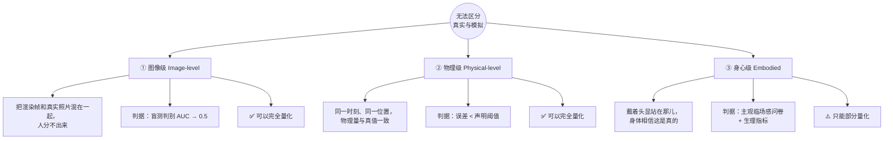

**这三条必须分别设目标、分别验收。** 目前的项目状态是：①差得最远且完全没有度量，②中上且度量最好，③几乎没有动。

### 现状总评分（按三个标准）

| 标准 | 完成度（我的估计） | 依据 |
|---|---|---|
| ① 图像级"无法区分" | **约 35–45%** | 全场景纯 Lambert 光照；除反照率外零材质贴图；无多重散射、无体积云、无水面反射；除地球/火星/月球外无真实地形；无后期（泛光/景深/镜头） |
| ② 物理级"无法区分" | **约 50–60%** | 行星/月球解析路径**实测 2–3″ 与 4×10⁻³°**，非常优秀；但卫星在拟合历元之外一年内退化到 **1.2–6.0°**，JPL 插值窗口只有 16 个月，窗外静默换模型；无 N 体/相对论/潮汐；ΔT 表冻结且 1800 年前误差达 208 s；玩家飞船完全没有引力 |
| ③ 身心级"无法区分" | **约 15–20%** | 无 3D 音频（全单声道）、无相机震动/着陆冲击、无电影模式、VR 无法移动/无触觉/无头显实机验证、无天气与季节 |

> **第一次通读代码就会发现一件事：项目文档里写的精度数字，与实际代码存在双向偏差。**
> 行星和月球**比文档写的更准**（文档写 0.074°，实际 VSOP87 截断路径约 2–3″，好 100 倍）；
> 卫星**比文档写的更差**（文档写"10 天 ≤0.22°"，实测离拟合历元一年后 Phobos 偏 6.0°）。
> 这说明"精度"目前是**由测试容差定义的，而不是由模型能力定义的**。这是阶段 0 必须解决的第一件事。

### 五个最致命的瓶颈（按"投入产出比"排序）

| # | 瓶颈 | 为什么致命 | 证据 |
|---|---|---|---|
| **1** | **没有真实度度量体系** | 无法判断任何一次改动是"更真"还是"更假"；无法宣布目标达成；无法防止回归 | `tools/` 有 130+ 探针脚本，全部是"不崩溃/不卡顿"断言；`.audit-reports/comparison.html` 只做"候选 vs 线上"截图对照，**没有任何一处把渲染结果与真实照片做量化比对** |
| **2** | **全场景纯 Lambert 光照 + 零材质贴图** | 这是"假"的最大单一来源。无气天体（月、水星、木卫、冥王星）的 Hapke 后向散射/冲日增亮完全缺失，月面看起来像石膏 | `planetMaterial.js:303` = `albedo * max(ndl,0) * uSunI`；`grep envMap\|normalMap\|roughnessMap\|MeshPhysicalMaterial src/` 返回 **0 行** |
| **3** | **真实地形只有地球/火星/月球，且被硬夹在 L4** | 代码请求到 L8，但数据只生成到 L4 → **月面全球只有 2.67 km/px**，阿波罗着陆区看不到坑沿 | `terrain.js:876` 请求 L8；`demTiles.js:46,55,64` `maxLevel: 4`；`demTiles.js:185` 静默夹断 |
| **4** | **玩家飞船没有引力，只是"相机"** | "1:1 模拟太阳系"的核心体验是飞；不飞就没法验证任何物理真实性 | `ship.js:445-524` `updateFly` 内**没有任何 gm 项**；没有阻力、没有燃料、没有碰撞（只有最近天体一个球） |
| **5** | **天空是 132 颗真星 + 11,900 个随机点 + 一张 JPEG** | 从地球地表抬头，星空是"无法区分"最容易露馅的地方 | `starfield.js:21-154`（132 颗 Hipparcos）、`:197-218`（LCG 随机点云）、`:165-184`（8K 银河贴图） |

### 关键洞察：目标不该是"完美"，而是"把可分辨距离推到人眼极限"

"处处无法区分"在工程上不可证明（见第 4 章）。**唯一可执行的目标形式是：把"可分辨距离 D_res"压到人眼极限以下，并且用盲测证明它。**

```
D_res(天体, 方向) = 该处表面采样间距 ÷ 人眼角分辨率(1′)
→ 观察者离表面远于 D_res 时，画面在物理上不可能暴露伪造
```

按这个尺子量，现状是：

| 天体 | 当前贴图 D_res | 当前地形 D_res | 目标 |
|---|---:|---:|---:|
| 地球 | 16,800 km | 33,600 km | 落地后 ≤ 数十米 |
| 月球 | 4,600 km | 9,200 km | 落地后 ≤ 数十米 |
| 火星 | 8,900 km | 17,900 km | 落地后 ≤ 数十米 |
| 木星 | 377,000 km | — | ≤ 5,000 km |
| 天王星 / 海王星 | **269,000 / 261,000 km** | — | ≤ 20,000 km |

> 读法：以天王星为例——你在距它 27 万公里（10 倍半径）处就能看出贴图糊了。要"从轨道上看不出破绽"，需要把贴图从 2048 提到 ~16K。

### 总工作量与周期

| 阶段 | 内容 | 全职等效 |
|---|---|---|
| 阶段 0 | 真实度度量与判别测试台（**不可跳过**） | 3–4 周 |
| 阶段 1 | 位置与形状（星历收紧 + 两级 DEM + 形状模型） | 3–4 个月 |
| 阶段 2 | 光与材质（物理辐射、BRDF、大气、云、水、环、太阳、后期） | 5–7 个月 |
| 阶段 3 | 环境与时间（天气、季节、太阳活动、精确食、地标） | 3–4 个月 |
| 阶段 4 | 临场（飞行力学、相机语言、空间音频、VR） | 3–5 个月 |
| 阶段 5 | 收口（性能、可访问性、内容、多语言） | 2–3 个月 |
| **合计** | | **约 17–24 个月全职等效** |

按项目目前的间歇式节奏（165 次提交、约 4 个月），现实预期是 **3–4 年**。

**但真正需要立刻做的只有两件事**：阶段 0 的度量台（3–4 周，决定后面每一步走得对不对），以及第 8.1 节列出的**五个"一两天速赢"**。这两块加起来不到一个月，却能同时消除最严重的错误、补上最缺的能力、并让后续所有投入可衡量。详见第 8 章。

---

# 第 1 章 把"无法区分"变成可判定的工程目标

## 1.1 为什么现有目标无法验收

"达到无法区分真实与模拟的程度"目前是不可判定的，因为它没有回答三个问题：

1. **在哪个尺度上？** 从 10 万 AU 看地球和站在地球上看一颗石子，"无法区分"的含义完全不同。
2. **对谁？** 人眼？相机？还是物理仪器？
3. **在哪个场景集上？** 如果只有 282 组固定截图，那就只能证明这 282 组。

`RELEASE_READINESS.md:9` 已经诚实地写下了这一点：*"不能宣布'整个太阳系、所有角度、所有硬件上均达到照片与模拟无法区分'"*。这份方案的第一步就是**把它变成可以宣布的东西**。

## 1.2 核心概念：真实度前沿与可分辨距离

把太阳系按"观察者离表面的距离"分成三个域，每个域有不同的失效机制：

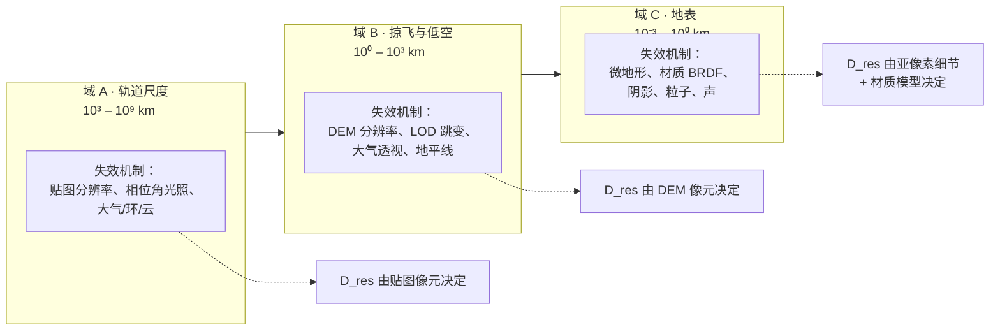

**D_res 定义**（本方案的核心工作指标）：

$$D_{res} = \frac{s}{\theta_{min}}, \qquad s = \frac{2\pi R}{N_{px}}$$

- `s` = 表面采样间距（贴图像元或 DEM 像元）
- `θ_min` = 观察者角分辨率阈值（人眼 ≈ 1 角分 = 1/3438 rad）
- 含义：**观察者比 D_res 更近时，画面开始暴露它是假的**

**这个指标的价值**：它把一个含糊的"像不像"变成一个有单位、可计算、可进 CI 的数字。每加一层 DEM、每换一次贴图，都能立刻算出 D_res 前进了多少。

## 1.3 三个域的具体验收定义

| 域 | "无法区分"的可操作定义 | 测量方法 |
|---|---|---|
| **A 轨道** | 在 20 个标准视点（天体 × 相位角 × 距离）上，渲染图与同几何真实影像混排，人类判别 AUC ≤ 0.60 | 盲测平台 + 参考图像库 |
| **B 低空** | 在 12 个地标（阿波罗 11/17、好奇号、毅力号、奥林帕斯山、水手谷、珠峰…）100 km / 10 km / 1 km 三个高度上，地平线剖面与真实影像的**逐像素高程剖面**误差 < 声明阈值 | 地平线轮廓提取 + 高程反演 |
| **C 地表** | 落地后静止 10 秒，与同地点真实照片（阿波罗、火星车实拍）盲测 AUC ≤ 0.60；且**无任何时序伪影**（LOD 跳变、贴图 pop、光照闪烁） | 盲测 + 时序差分检测 |

## 1.4 判别测试协议（唯一合法的"无法区分"证明）

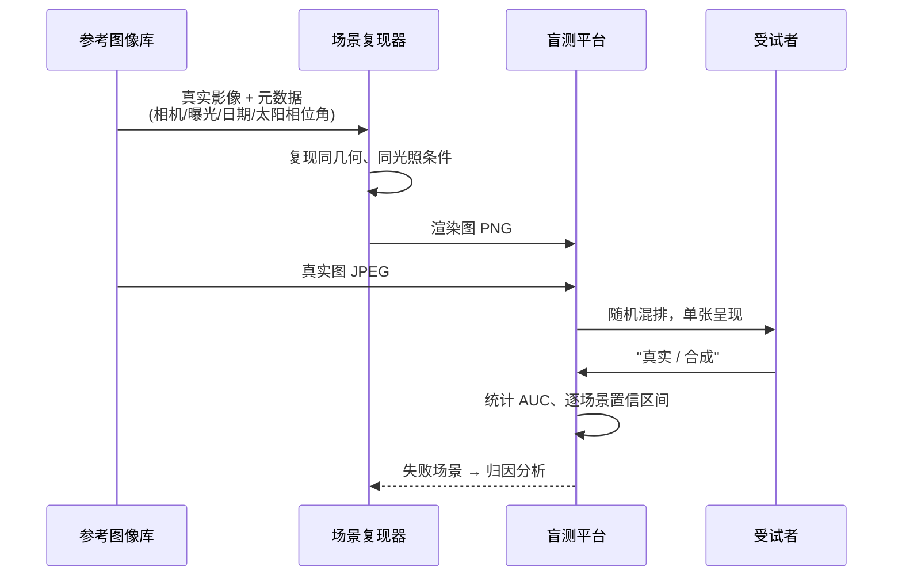

协议硬性要求（缺一不可）：

1. **参考图必须是真实影像**，不是官方渲染图（NASA 的部分"渲染图"也是 CG，会污染结果）。每条记录必须带来源、日期、相机、曝光。
2. **几何必须对齐**：同一时刻、同一相机位姿、同一 FOV。否则测的是"角度对不对"而不是"像不像"。
3. **显示条件固定**：同一显示器、同一亮度、同一观看距离。亮度不同，暗适应结论就会翻转。
4. **样本量 ≥ 30 受试者 × ≥ 60 图对**，报告 AUC 的 95% 置信区间。
5. **合成图不得有分辨率优势或劣势**：必须把两边归一到同一像素尺寸与同一噪声水平，否则受试者靠"哪张更锐"就能分辨。

> **重要提醒**：LPIPS / SSIM 只能用作**回归监控**，不能用作"无法区分"的证明。它们是学出来的感知距离，在跨域（渲染 vs 实拍）比较时与人类判断相关性不稳定。**唯一合法的判据是盲测。**

---

# 第 2 章 现状体检（可复现的证据基线）

## 2.1 已经做对的部分（不要重做）

这些是真正的资产，方案中只做增量，不动地基：

| 已达成 | 证据 |
|---|---|
| 1:1 真实 km 尺度，0.5 m → 10 万 AU | 浮动原点（`floating.js:19-27`，double 相减后再窄化）+ 对数深度（`rendererBootstrap.js:15`） |
| 行星星历与 JPL Horizons 逐点吻合 | 520/520 项独立对照（`RELEASE_READINESS.md:35`）；65 个目标的 JPL 采样星历（`public/data/ephemeris/*.bin`，14 MB，2026-06 → 2027-10，SHA-256 校验） |
| HDR 管线已建立 | `main.js:86-90` HalfFloat + LinearSRGB；High 档 4× MSAA，Low 档 FXAA |
| 大气单次散射物理正确 | `atmosphere.js:121-162` Nishita 式，逐通道 Rayleigh/Mie 系数 + HG 相位函数；火星蓝色日落由 `mieG:[0.60,0.65,0.72]` 自然涌现（`bodies.js:76-78`） |
| 真实 DEM 管线（三星体）+ 无缝拼接 | `demTiles.js` 四叉树 + LRU + 全局连续像素双线性（`:294-338`，专门解决瓦片接缝） |
| 环-行星互影（解析） | `planetMaterial.js:286-302` 太阳光线与环平面求交；`rings.js:109-116` 行星本影投到环上 |
| 月球/火星/地球地表已可落地行走 | 环形 LOD 8 级（`terrain.js:584-630`）+ 形状驱动粗糙度 + 近场 ±400 m 阴影（`builder.js:355-364`） |
| 渐进加载与失败恢复 | L1 预览 0.36 MB → L2 1024px → L3 焦点原图；弱网 5 s 可进入（`RELEASE_READINESS.md:88`） |
| 硬件自适应分档 | `quality.js` GPU 分类 + P95 帧间隔守卫 + 动态分辨率 1/0.88/0.76/0.65 |
| 136 项离线测试全通过 | `npm test` 实测 136/136 |

## 2.2 资产分辨率实测（这是"假"的物理上限）

**贴图**（`public/textures/`，23 张）：来源全部为 Solar System Scope（CC-BY-4.0，基于 NASA/USGS 数据的二次合成）与 Steve Albers 的 Science on a Sphere 合成图（`tools/fetch-textures.mjs:1-4`）。

| 天体 | 原图像素 | 表面像元 | **贴图 D_res** | 判定 |
|---|---:|---:|---:|---|
| 地球 | 8192×4096 | 4.89 km | 16,800 km | 只在 2.6 倍地球半径外才无破绽 |
| 月球 | 8192×4096 | 1.33 km | 4,600 km | 尚可 |
| 火星 | 8192×4096 | 2.60 km | 8,900 km | 尚可 |
| 水星 | 8192×4096 | 1.87 km | 6,400 km | 尚可 |
| 金星 | **2048×1024** | 18.6 km | 63,800 km | 差 |
| 木星 | 4096×2048 | 109.7 km | 377,000 km | 差（大红斑是贴图上的一个色块） |
| 土星 | 4096×2048 | 92.5 km | 318,000 km | 差 |
| 天王星 | **2048×1024** | 78.4 km | 269,000 km | **差（10 倍半径处即露馅）** |
| 海王星 | **2048×1024** | 76.0 km | 261,000 km | **差** |
| 冥王星 | 4096×2048 | 1.82 km | 6,300 km | 尚可 |
| 木卫二 | 4096×2048 | 2.39 km | 8,200 km | 尚可 |
| 木卫四 | **1800×900** | 5.44 km | 18,700 km | 差 |

> 另有 **0 张法线贴图、0 张粗糙度贴图、0 张高光贴图、0 张位移贴图**——`grep -r "normalMap\|roughnessMap\|envMap\|MeshPhysicalMaterial" src/` 返回 0 行。

**地形**（`public/dem/`，123 MB，3 个天体 × 342 瓦片）：

| 天体 | 数据源 | 当前最细 | 真实数据可到 | 差距 |
|---|---|---|---:|---:|---|
| 月球 | LOLA | L4 = 4096 px = **2.67 km/px** | 118 m/px（全球） | **23×** |
| 火星 | MOLA | L4 = 4096 px = **5.20 km/px** | 463 m/px（全球）；HiRISE DTM 1 m/px（1200+ 处） | **11×** |
| 地球 | ETOPO1 | L4 = 4096 px = **9.77 km/px** | SRTM 30 m/px | **326×** |
| 其余 ~28 个可着陆天体 | **无** | 纯程序化噪声 | 水星 MESSENGER、金星 Magellan、冥王星 New Horizons、伽利略/卡西尼 DTM | — |

**致命细节**：`terrain.js:876` 在贴地行走时**请求 L8**，但 `demTiles.js:185` 静默 `Math.min(level, maxLevel=4)`。也就是说**代码的意图和数据的现实之间有一个 16 倍分辨率的鸿沟，而且被无声吞掉了**。

**其他资产**：小型天体 5412 颗（`public/data/smallbodies.json`，478 KB）；卫星 21 颗；TNO 28 颗；彗星 4 颗；恒星 132 颗真实 + 11,900 颗随机；构建产物 224 MB。

## 2.3 "假"的直接来源清单（渲染层实测）

| 位置 | 现状 | 后果 |
|---|---|---|
| `planetMaterial.js:303` | `albedo * max(ndl,0) * uSunI` | **纯 Lambert**。无气天体没有冲日增亮，月面像石膏 |
| `atmosphere.js:228-232` | 多重散射 = 一个标量补偿项 `β*insc/(4π) * msFrac² * 0.35` | 黄昏、临边、云下亮度都不对 |
| `atmosphere.js`（全文） | **无臭氧层** | 暮光蓝色带、"金星带"无法正确形成 |
| `builder.js:405` | 地球云 = `R*1.0035` 的单层贴图球壳 | 无体积、无云影、无云顶高度、无临边高光 |
| `sun.js:129-131,167` | 日冕是 12 R☉ 的**朝向相机的公告板**，且 `occulted ? 1 : 0.000001` | **除日全食外日冕几乎不可见** |
| `sun.js`（全文） | 无日珥、无色球、无过渡区、无太阳风；临边昏暗只有一阶 `0.35+0.65μ` | 太阳是最容易识别"假"的天体之一 |
| `main.js:92` | **明确禁用泛光** | 缺少人眼/相机最显著的过曝特征 |
| `main.js:86-103` | 无景深、无运动模糊、无镜头光晕/鬼影、无色差、无颗粒、无 TAA | 画面"太干净"，一眼是 CG |
| `rings.js:34-50` | 环 = 256 段 × 2 顶点的**零厚度平面** | 无自阴影、无辐条、无粒子、无厚度 |
| `terrain.js:411-432` | 水面 = 三条噪声法线 + 固定 roughness 0.12 | 无反射、无折射、无次表面、无真实浪谱 |
| `belts.js:33-47` | 小行星带 14,000 点、柯伊伯带 9,000 点、奥尔特云 4,000 点，**位置恒定不动** | 示意几何，不是模拟 |
| `eclipses.js:133-181` | 食 = 场景里插入的**黑锥体网格**（MultiplyBlending） | 半球表面本身不变暗；无贝利珠、无色球环、无影带 |
| `builder.js:425-428` | 远距天体 = 屏幕空间 glint 精灵，尺寸 `dist*0.004` | 非真实反射辐亮度 |

---

# 第 3 章 缺口总清单

> 分级：**P0** = 阻断"无法区分"这个结论；**P1** = 明显可感知；**P2** = 打磨。
> 每项给出：现象 → 证据 → 影响 → 方案编号（对应第 5 章）。

```mermaid
flowchart TB
    ROOT["真实度缺口"]
    ROOT --> A["A 星历与动力学<br/>位置对不对"]
    ROOT --> B["B 几何与地形<br/>形状对不对"]
    ROOT --> C["C 光与材质<br/>颜色亮度对不对"]
    ROOT --> D["D 环境与时间<br/>此刻对不对"]
    ROOT --> E["E 感知与临场<br/>我在不在"]
    ROOT --> F["F 工程与资产<br/>跑不跑得动 / 素材哪来"]

    A --> A1["A1 ΔT 表冻结且历史错误"]
    A --> A2["A2 无光行时/光行差"]
    A --> A3["A3 卫星仅经验拟合"]
    A --> A4["A4 小天体 5412/百万"]
    A --> A5["A5 无 N 体/相对论/潮汐"]

    B --> B1["B1 DEM 被夹在 L4"]
    B --> B2["B2 28 个天体无地形"]
    B --> B3["B3 小天体全是球"]
    B --> B4["B4 土星环零厚度平面"]

    C --> C1["C1 纯 Lambert 无 BRDF"]
    C --> C2["C2 零材质贴图"]
    C --> C3["C3 大气无多重散射/臭氧"]
    C --> C4["C4 无体积云"]
    C --> C5["C5 水面无反射折射"]
    C --> C6["C6 太阳无日冕/日珥/光晕"]
    C --> C7["C7 无后期处理"]

    D --> D1["D1 天气/季节是程序化的"]
    D --> D2["D2 食是锥体不是阴影"]
    D --> D3["D3 无太阳活动"]
    D --> D4["D4 无黄道光/气辉"]

    E --> E1["E1 玩家无引力/无阻力/无碰撞"]
    E --> E2["E2 无相机语言"]
    E --> E3["E3 音频全单声道"]
    E --> E4["E4 VR 不能移动"]

    F --> F1["F1 无真实度度量"]
    F --> F2["F2 资产是二次合成"]
    F --> F3["F3 许可台账不全"]
    F --> F4["F4 仅两档画质"]
```

## A. 星历与动力学

> **好消息先说**：行星与月球的解析路径实测精度**远好于项目自述**——VSOP87 截断到 ~0.1″ 阈值后，9 颗行星最差 8.8×10⁻⁴°（≈3″）、月球 Meeus 60+60 项最差 3.9×10⁻³°。所以下面的 A 类问题**不是"星历不准"，而是"边界与长期行为不可靠"**。

| 编号 | 现象 | 证据（含实测） | 影响 | 级别 |
|---|---|---|---|---|
| **A1** | **ΔT 闰秒表冻结在 2017，且 1972 年前套用了错误的 2005–2050 多项式** | `time.js:22-34` 表尾止于 `2017-01-01`；`time.js:45-47` 对 `jd < 1972` 用 `62.92+0.32217t+0.005589t²`（该式仅 2005–2050 有效）。**实测误差：1900 年 +89 s、1800 年 +208 s、公元 1000 年 +0.06 天、公元前 3000 年 +1.60 天** | 一切历史时刻的晨昏线、地方时、月球位置都错（1800 年地球自转差 0.87°）。**而"时间机器"正是项目的核心卖点** | **P0** |
| **A2** | **卫星解析回退一年内退化到 1.2–6.0°**（文档写的是 ≤0.22°） | 实测（相对 JPL，离拟合历元 JD 2461273.69）：Io +134 d **1.73°** / +224 d **2.77°**；Phobos +405 d **6.01°**；Charon +405 d **2.64°**；而 `tests/ephemeris.test.mjs:45-51` 只在拟合历元附近单点采样，因此测试通过 | **任何日期超出 2026-06-01…2027-10-01 窗口、或 `.bin` 未加载时，卫星系统肉眼可见地错**（木卫排布是伽利略就能看见的特征） | **P0** |
| **A3** | **`moonsData` 中的月球条目本身是错的** | `moonsData.generated.js` 中 moon 的 `nDegPerDay = 11.8138` ⇒ 周期 30.47 天，真值 27.32 天（**+11.5%**）；拟合出的月球交点退行率 −0.12°/年，真值 −19.3°/年（**差 160 倍**）。月球的**位置**不走这条路径（走 Meeus/采样），但**轨道法线**走（`builder.js:610`），而法线决定潮汐锁定姿态 | 月球与所有潮汐锁定卫星的**朝向**可能系统性偏斜 | **P0** |
| **A4** | 无章动（任何地方） | `grep nutation src/` → 无匹配。IAU 2000A 章动振幅 ±17.2″ = 0.0048°，**比行星自身误差还大 7 倍** | 岁差链不完整；极轴/晨昏线在精密比对时对不上 | P1 |
| **A5** | 无光行差（observer aberration）、无太阳光线偏折、无 Shapiro 延迟 | 光行时只有行星/卫星/TNO/彗星各做 2 次定点迭代（`builder.js:521-532`、`comets.js:141-156`）；恒星无周年光行差 | 恒星位置差 20″；太阳边缘星光偏折 1.75″ 未建模 | P1 |
| **A6** | **JPL 采样窗口只有 16 个月，窗外静默换模型** | `public/data/ephemeris/manifest.json`：2026-06-01 → 2027-10-01；`sampledEphemeris.js:33` 越界返回 `null` 并回退解析模型 | HUD 有警告，但卫星在窗外**错 2–6°**。这是"某天早上应用突然变差"的定时炸弹 | **P0** |
| **A7** | 行星与月球实为球体，**扁率被忽略** | `builder.js:394` 只对**不可着陆**天体做 `scale.y` 压扁；地球（扁率 0.00335 ≈ 21 km）、火星（0.00589）、水星、金星、冥王星与全部卫星都渲染成正球 | 地球极半径差 21 km；从极区看地平线会错 | P1 |
| **A8** | 卫星只有 21 颗（实际 ~890 颗）：土星 6/60+、天王星 5/27、海王星 1/16、冥王星 0/4、TNO 卫星与**小行星卫星全部为 0** | `moonsData.generated.js` 键枚举 | 土卫六以外的土星系、天卫、海卫、冥卫二三等全部缺失 | P1 |
| **A9** | 任何潮汐锁定天体**均无天平动**；月球"可见 59% 表面"这一经典事实无法呈现 | `rotation.js:102-115` 100% 潮汐锁定姿态 | 月面地出的位置与朝向不真实 | P1 |
| **A10** | 小天体：5412 颗（3,199 主带 + 448 NEO + 1,765 周期彗星），共用单历元 2461200.5，纯二体开普勒 | `public/data/smallbodies.json`；`smallBodies.js:61-85`；`tools/fetch-small-bodies.mjs:16,30-32` | 无摄动、无非引力项、无形状/自转/反照率；**Ceres/Vesta/Pallas/Juno 没有作为"世界"存在** | P1 |
| **A11** | 小行星带 / 柯伊伯带 / 奥尔特云是**静态点云，永不移动** | `belts.js:7-47`（无 `update`）；14,000 + 9,000 + 1,400 + 2,600 点 | "1:1 模拟整个太阳系"在这层不成立 | P1 |
| **A12** | 只有 4 颗彗星，且哈雷的轨道根数是 **1976 年**的密切元素、无非引力项 | `cometOrbits.generated.js`（halley epoch JD 2439875.5 = 1976-04-22） | 哈雷回归时间会差数天；无星际天体（1I/2I 被 `e<1` 过滤掉） | P2 |
| **A13** | 28 颗 TNO 的 `nodeDot` / `periDot` **全部为 0** | `tnoOrbits.generated.js` 逐对象核对 | 交点与近日点冻结，无 3:2 共振、无 Kozai 循环、无散射盘混沌 | P2 |
| **A14** | 无 N 体、无摄动、无相对论、无潮汐演化、无 J2 动力学 | 全仓库 `grep nbody\|perturbat\|J2\|tidal\|relativis\|integrat` → 唯一命中是 `surfaceGravity = GM/r²`（`bodies.js:253-255`） | 水星进动 42.98″/世纪、月球退行 3.8 cm/年、Io 潮汐加热全部缺失 | P2 |
| **A15** | 冥王星不在 VSOP87 中，回退 Standish，实测 7.8×10⁻³°（比其余行星差 12 倍） | `vsop87.js:20,88-93,120-148` | 冥王星是热门目标，精度反而是最差的 | P2 |
| **A16** | 未实现 JPL Table 2b（3000 BC–3000 AD 项），README 的"±3000 年"缺少行星路径支撑 | `planets.js:14-51`；`README.md:127` | 与 A1 叠加，远古/未来日期不可信 | P2 |
| **A17** | 死代码与过期注释：`moonGeocentricFast`（7 项粗序列）无人引用；VSOP87 注释称"0.001″/50–100 KB"实际为 0.1″/116 KB；月球注释称"0.2–0.3°"实测 4×10⁻³° | `moon.js:22-57`；`vsop87.js:3`；`moon.js:19` | 维护者会被误导 | P2 |

## B. 几何与地形

| 编号 | 现象 | 证据 | 影响 | 级别 |
|---|---|---|---|---|
| **B1** | **DEM 数据只生成到 L4，代码请求到 L8 被静默夹断** | `terrain.js:876` vs `demTiles.js:46,55,64,185` | 月面 2.67 km/px，阿波罗着陆区看不到坑沿。**这是"走到地面就露馅"的主因** | **P0** |
| **B2** | 水星、金星、冥王星、木卫、土卫、天卫等 **~28 个可着陆天体完全无地形** | `terrain.js:134-160` 纯 fbm/ridged 噪声；`demTiles.js:38-66` 只有 3 个源 | 探索这些天体时"程序感"极强 | **P0** |
| **B3** | DEM 以下的细节是固定幅度 ≤1.6 m 的合成噪声，与真实地形粗糙度无关 | `terrain.js:122-131`（注释自述"这是细节，不是实测 DEM"） | 月面微观质感不真实 | P1 |
| **B4** | 撞击坑是噪声等值线，无中央峰/射纹/溅射毯/退化态 | `terrain.js:66-72` | 月球最标志性的地貌特征不对 | P1 |
| **B5** | 岩石是变形二十面体，散布参数硬编码（22 m 格 / 330 m 半径 / 320 块） | `terrain.js:467-481, 367-406` | 近景重复感 | P2 |
| **B6** | 小天体全是球体，无真实形状模型（67P、Bennu、Itokawa 等 PDS 均有） | `terrain.js:614-621` 用连续高度场 | 无法访问最具辨识度的小天体地貌 | P1 |
| **B7** | 土星环零厚度平面；天王星环是程序合成的高斯带；**木星与海王星环完全不存在** | `rings.js:34-50`；`bodies.js` 仅 Saturn `:111` / Uranus `:123` 有 rings | 环系是 Cassini 最著名的画面 | **P0** |

## C. 光与材质（**收益最大的类别**）

| 编号 | 现象 | 证据 | 影响 | 级别 |
|---|---|---|---|---|
| **C1** | **全场景纯 Lambert 反射** | `planetMaterial.js:303` | 无气天体无冲日增亮（真实月面在满月时亮度可增 40%+）；有气天体无 Oren-Nayar 粗糙度效应 | **P0** |
| **C2** | **零材质贴图**（无法线/粗糙度/高光/AO/位移） | `grep` 全仓库 0 行 | 地表看起来像"贴了照片的球" | **P0** |
| **C3** | 多重散射是标量补偿；**无臭氧层** | `atmosphere.js:228-232`；`grep ozone` → 0 行 | 暮光色带、金星带、临边亮度全错 | **P0** |
| **C4** | 地球云是单层贴图球壳，无体积、无云影、无高度 | `builder.js:405`；`planetMaterial.js:354-426` | 从轨道看地球"平" | **P0** |
| **C5** | 水面无反射/折射/次表面；波是三条噪声法线 | `terrain.js:411-432` | 海面是"哑光的蓝色" | **P0** |
| **C6** | 太阳：日冕公告板且平时不可见；无日珥/色球/太阳风；临边昏暗一阶 | `sun.js:129-131,167,80-81` | 太阳是辨识度最高的天体，也是最假的 | **P0** |
| **C7** | **无任何后期处理**：无泛光、无景深、无运动模糊、无镜头光晕、无色差、无颗粒、无 TAA | `main.js:86-103`（泛光被显式禁用，`main.js:92`） | 缺少"相机/人眼"的物理特征，画面"过于干净" | **P0** |
| **C8** | 曝光是日心距离的纯函数，不测光 | `main.js:1145` `clamp(pow(dSunAU,0.85),0.25,12)` | 亮行星充满视野时不会自动压曝光 | P1 |
| **C9** | 气巨条带/大红斑/土星六边形全是程序化噪声或贴图象素 | `planetMaterial.js:172-216,257-262` | 木星大红斑位置与系统 III 经度不对应 | P1 |
| **C10** | 无行星互照（地照 earthshine）、无环照、无天空环境光 | `planetMaterial.js:325` 常数 `+albedo*0.0035`；`main.js:81` AmbientLight 0.02 | 月球夜面死黑 | P1 |
| **C11** | 冰巨/土卫有"人眼暗适应补偿" `I^0.55` 与 `interiorBoost` 之类显示 hack | `.audit-reports/engine.md:8.7`；`bodies.js:38` | 非物理提亮，与真实照片比对时会失败 | P1 |
| **C12** | 恒星只有 132 颗真实 + 11,900 随机点；4 档量化颜色；无视差（背景）/无自行/无 PSF | `starfield.js:21-154,197-218,210-215` | 星空是地表沉浸感的主要来源，目前不成立 | **P0** |
| **C13** | 无黄道光/对日照/气辉 | `belts.js:1-2`（明确不渲染） | 夜空少一层真实结构 | P2 |
| **C14** | 彗尾是 Sprite + 圆柱 + 220 个点；4 颗彗星 | `comets.js:78-108,96-99` | 彗星不真实 | P2 |

## D. 环境与时间

| 编号 | 现象 | 证据 | 影响 | 级别 |
|---|---|---|---|---|
| **D1** | 无动态天气：地球云不随时间/日期变化；火星尘暴是 Ls 驱动的噪声；木星大红斑漂移是视觉近似 | `planetMaterial.js:227-238,148-172` | 同一天体的画面与真实日期脱钩 | **P0** |
| **D2** | 食用黑锥体网格叠加，接收体表面光照不变 | `eclipses.js:133-181`；`.audit-reports/astro.md:7.4` | 日全食时天空不变暗，无贝利珠/色球 | P1 |
| **D3** | 食搜索仅 `alignment > 0.999` 三体共线；仅硬编码 4 组三元组 | `eclipses.js:37-89,212-246` | 大量掩星事件被漏掉 | P1 |
| **D4** | 无太阳活动周期（黑子位置随机，无蝴蝶图）、无耀斑、无 CME | `sun.js:76-77`；`.audit-reports/engine.md:8.4` | 太阳表面与真实日期无关 | P1 |
| **D5** | 无季节视觉：火星极冠为程序化混合、地球极冠是日下点纬度驱动的白混 | `planetMaterial.js:229-242,312-323` | 极冠/海冰与真实日期不符 | P1 |
| **D6** | 无地球夜面气辉、无城市灯光时相变化 | `planetMaterial.js:326-331`（贴图 + 3.0 增益） | 夜间地球是静态的 | P2 |
| **D7** | 高倍速时间下严重时域混叠：10 年/秒时**一帧 = 61 天** | `hud.js:11`（上限 315576000×）；`time.js:112`；`eclipses.js:223` | 水星轨道、自转相位、食事件被跳过 | P1 |

## E. 感知与临场

| 编号 | 现象 | 证据 | 影响 | 级别 |
|---|---|---|---|---|
| **E1** | **玩家飞船完全没有引力**：`updateFly` 内无任何 gm 项 | `ship.js:445-524`（`gm` 只在 `updateWalk:578` 用到） | 无法自由落体、无法入轨、无法驻留；停手地球就飞走 | **P0** |
| **E2** | 无大气阻力/升力/气动加热/再入 | `ship.js` 全文；`inAtmosphere` 只用于音频 | 再入是最具冲击力的沉浸场景，目前完全没有 | **P0** |
| **E3** | 无质量/推力/比冲/燃料/Δv；速度为第一阶滞后或恒定加速度；上限 1000 c | `ship.js:389-390,479-485` | 不是航天动力学，是"相机平移" | **P0** |
| **E4** | 碰撞仅"最近天体一个球"，无视地形起伏 | `ship.js:502-515`；`main.js:1000-1015` | 可以 5 m 高度**穿过山脉** | **P0** |
| **E5** | 行走无坡度限制、无横向碰撞、无加速度/摩擦模型；DEM 更新 >5 m 时**静默竖直传送玩家** | `ship.js:618,622,657-677` | 可走上垂直悬崖，可穿过岩石；落点会"跳" | P1 |
| **E6** | 水下浮力是常数"半重力向上"，非阿基米德 | `ship.js:630,642` | 水下行为不物理 | P1 |
| **E7** | 玩家物理与仿真时间解耦（用 dtReal），无法跟随运动天体 | `main.js:704,752`；`time.js:112` | 1× 速度下无法与任何天体保持相对静止 | P1 |
| **E8** | **无相机语言**：无震动、无头部晃动、无着陆冲击、无 FOV 冲击 | `grep -rn "shake\|bob" src/` → 0 行 | 一切动作都"没有重量" | **P0** |
| **E9** | **音频全单声道**：无 PannerNode / AudioListener / HRTF / 多普勒 / 混响区；仅 4 层合成音；默认静音 | `audio.js:283,312`（全部接同一 bus）；`grep PannerNode\|PositionalAudio` → 0 行 | 空间听觉完全缺失 | **P0** |
| **E10** | 无引擎/推进器/再入/UI 音效；`setVolume`/`setVacuum` 在 `src/` 内无调用方 | `audio.js:87`；grep 无调用 | 音量和真空嘶声在 UI 上够不到 | P1 |
| **E11** | VR：飞/走模式无移动（`main.js:1378` 早退）、无触觉、无手追、无舒适选项、**post 链路被跳过**、控制器拾取是空桩 | `webxr.js:317-324`（`_raycastBody` 恒返回 null）；`main.js:976-977` | VR 实际上只能缩放和选目标 | **P0** |
| **E12** | 无真机验证：仅 Chrome 触控/UA 仿真；无 AMD/Apple/真手机/Safari/头显 | `RELEASE_READINESS.md:77,112` | 不能宣称"全硬件" | P1 |
| **E13** | **无"电影/纯净模式"**：没有任何一个按键或入口能一次性隐藏 HUD、目录、提示、准星、标签、罗盘 | 逐元素开关只有 `H/L/O/K/C`（`main.js:1046-1101`）；`grep cinematic\|photoMode\|hideUI` → 0 行 | 截图、录屏、VR、演示全都带着仪表盘。**这是投入产出比最高的一项：半天工作量** | **P0** |
| **E14** | **导览的 `action` 字段从未被执行** | 检查点声明 `action:'land'\|'lookAt'\|'zoomOut'`（`tours.js:55-59,271-307,199-203`），但 `main.js:315-326` 只传 `flyTo/select/getMode/setMode/hud`，**从不读 `cp.action`** | 三条导览里"降落到月球表面""转身面对地球""拉远到奥尔特云"的**旁白与画面不符**——镜头从不落地、从不转身、从不拉远 | **P0** |
| **E15** | **导览旁白被 CSS 裁掉** | `#hud-tip` 是 `white-space:nowrap; max-width:90vw` 且**无 `overflow` 规则**（`style.css:62-67`），而 `body{overflow:hidden}`（`style.css:5`）；导览文案 150–300 字（`tours.js:61-67`）写进这个元素（`tours.js:527-533`） | 产品里最重要的解说词**读不全**，且没有字幕层 | **P0** |
| **E16** | **每个标签都带实时距离数字，无法只显示名称** | `labels.js:101` 每帧把 `formatDist()` 写进 `.ld`；无亮度/星等分级、无"仅最近 N 个"预算，最多 199 个 DOM 标签 | 天空变成测量仪表盘，不是天空 | P1 |
| **E17** | 无新手引导；全仓库 `localStorage` 只用于书签 | `grep onboard\|tutorial\|firstRun src/` → 0 行 | 三条导览、教师工具、书签全都没有入口 | P1 |
| **E18** | **可访问性基本缺失** | `user-scalable=no`（`index.html:5`）；CSS 中**无任何 `:focus-visible`**；标签/搜索结果是无 `tabindex`/`role` 的 `<div>`；无 `aria-live`；`prefers-reduced-motion` 只作用于启动页动画（`style.css:872-878`）；无色彩盲模式 | WCAG 1.4.4 等硬性失败 | P1 |
| **E19** | **PWA 清单存在但没有 Service Worker** | `public/manifest.json` 声明 `display:fullscreen`；`grep serviceWorker\|workbox src/` → 0 行 | 86 MB 贴图 + 123 MB DEM + 14 MB 星历**无法预缓存**；教师工具承诺的"拷到 U 盘离线打开"不成立 | P1 |
| **E20** | 教育/工具模块"有实现、无入口"：教师工具包、书签管理、TTS 的语速/音量/音色、真空音效开关 | `teacher.js` 仅被实例化并挂到 `window.__game`（`main.js:329-335`）；`bookmarks.js:115-151` 无 UI；`tts.js:135-153` 的 `setRate/setVolume/setPitch` 无调用；`setVacuum` 无 UI | 大量已完成的功能睡着 | P2 |
| **E21** | Ceres/Vesta 等 5412 颗真实小天体、阿波罗/火星车地标**不可搜索、不显示标签、不能前往** | `main.js:400-450` 的 `buildRegistry` 从不产出 `kind:'poi'`，`search.js:158` 的 `KIND_LABEL.poi` 是死代码 | 最有故事性的地点反而去不了 | P1 |
| **E22** | 主循环每帧重建 3 次 HUD `innerHTML` + 199 个标签各一次 `clone().project()` 与一次 DOM 查询 | `hud.js:75,103,133`；`labels.js:84,101` | 每帧白扔 5–10 ms，直接和渲染预算抢 | P1 |

## F. 工程与资产

| 编号 | 现象 | 证据 | 影响 | 级别 |
|---|---|---|---|---|
| **F1** | **没有真实度度量体系** | `tools/` 130+ 脚本全是功能/性能断言；无参考图像库、无感知指标、无盲测 | **无法验收"无法区分"** | **P0** |
| **F2** | 贴图全部是二次合成（Solar System Scope / Steve Albers），非 USGS/LROC/Cassini 原始科学镶嵌 | `tools/fetch-textures.mjs:1-4` | 分辨率与色彩都不是上限 | P1 |
| **F2b** | **31 个天体中只有 18 个有贴图**：火卫一/二、土卫一/二/三/四/五/八、天卫一/二/三/四/五全部走程序化兜底 | `public/textures/` 实际文件数 vs `bodies.js` 天体清单 | 这些卫星在轨道上看就是"假球" | **P0** |
| **F2c** | 28 颗 TNO 与 4 颗彗星**没有任何贴图** | 同上 | 全部为程序化噪声 | P1 |
| **F2d** | 已下载的 `newhorizons.bin` 与 `SPACECRAFT_TIMELINES` 是**死资源/死导入**，只实例化了旅行者 1/2 | `main.js:46,181-195`；`spacecraft.js:265-320` | 白付了体积，新视野号用不上 | P2 |
| **F3** | 未建立逐像素观测来源与不确定性台账 | `RELEASE_READINESS.md:149` | 无法标注"哪里是猜的" | P1 |
| **F4** | 只有 High / Low 两档；无带宽感知；VR 内无动态分辨率 | `quality.js:3-14,29-30,75-78` | 中端设备无合适档位 | P1 |
| **F5** | `src/engine/` 下**零测试** | `tests/` 只有 5 个星历/物理测试文件 | 引擎改动无回归保护 | P1 |
| **F6** | 渲染精度：远端实体位置存 fp32，1 AU 处 ULP ≈ 16 km，10⁴ AU 处 ≈ 10⁶ km | `floating.js:19-27` | 远处小天体会跳变 | P1 |
| **F7** | 构建产物 224 MB，其中 DEM 123 MB | 实测 | 部署与首屏压力 | P2 |

---

# 第 4 章 根本限制（必须先承认的边界）

这一章是诚实的部分。**下面四条限制无法通过工程手段消除**，方案的设计必须绕开它们，而不是假装它们不存在。

## 4.1 观测数据的边界：不可知区域永远不可知

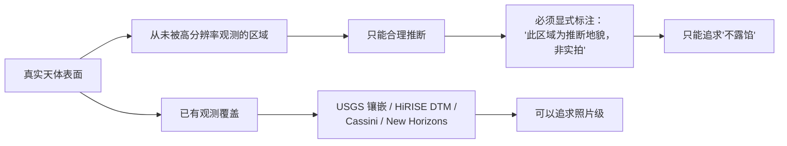

**具体数字**：火星全球 MOLA 463 m/px 有覆盖，但 HiRISE 1 m/px 的 DTM 到 2026 年也只有 **1,200+ 处**，覆盖不到火星表面的 2%。月球 LOLA 全球 118 m/px 覆盖完整，但 **5 m/px 级只覆盖有限区域**。地球 SRTM 30 m 覆盖 60°N–56°S，极区与海床要靠 GEBCO（约 450 m）。

**结论**：真实度目标必须是**分层的**——

- **有真实观测的区域** → 追求"与实拍照片无法区分"
- **推断区域** → 追求"不暴露推断痕迹"（统计学上合理的粗糙度、合理的坑密度）
- 并且**必须在 UI 上可切换显示"证据等级"**，这是科研级诚实，也是教育价值。

## 4.2 浏览器算力边界：实时全局光照不可能

| 想要的效果 | 物理正确的做法 | 实时可行性 | 必须用的近似 |
|---|---|---|---|
| 大气多次散射 | 全路径追踪 | ✗ | 预计算 LUT（Bruneton 式） |
| 体积云 | 高步数 raymarch + 多次散射 | ✗ | 低步数 + 预计算光照 + 时域重用 |
| 行星互照 GI | 全局光照 | ✗ | 解析近似 + 球谐环境光 |
| 真实水面 | 光线追踪反射/折射 | ✗ | SSR + 屏幕空间折射 + 预滤波环境图 |
| 环系粒子 | 10⁹ 粒子 | ✗ | 贴图光学深度 + 稀疏粒子叠加 |
| 无气天体 BRDF | Hapke 全式积分 | △ | 预积分 BRDF LUT（与 PBR 同样做法） |

**结论**：所有"物理正确"都必须以**预计算 + 近似**的形式落地，并且**每一个近似都要有与真值的误差上界**。这就是为什么阶段 0（度量）必须最先做——它决定了每个近似"够不够好"。

## 4.3 可判定性边界："处处无法区分"不可证明

无法穷举：约 30 个天体 × 连续视点 × 连续时间 × 连续光照条件。**因此正确的目标形式是：**

$$\text{目标} = \big(\text{场景集 } \mathcal{S},\ \text{判别阈值 } \tau\big) \quad\text{使得}\quad \text{AUC}(\mathcal{S}) \le \tau$$

**"无法区分"= 在一个明确声明、可复现、可扩展的场景集上通过盲测。** 场景集越大越有说服力，但永远不是"全部"。这必须在文档和对外表述中写清楚。

## 4.4 结论：目标应当这样重写

> **原目标**：完美逼真，1:1 模拟整个太阳系，达到无法区分真实与模拟的程度。
>
> **可执行目标（建议对外采用）**：
>
> **G1｜图像级**：在声明场景集 `S` 上（首批 60 个视点，每季度扩充），**人类盲测 AUC ≤ 0.60**。
> **G2｜物理级**：位置误差 ≤ 1×10⁻⁴°（vs JPL）；历史时刻 ΔT 误差 ≤ 0.5 s；地表 DEM 在有观测区域 ≤ 5 m/px。
> **G3｜体验级**：在真机上完成 30 分钟不间断任务（地表行走 → 起飞 → 入轨 → 星际转移 → 再入 → 着陆），无任何时序伪影，主观临场感量表 ≥ 4.0/5。
> **附则**：所有推断区域在 UI 上标注证据等级；所有近似在文档中给出误差上界。

---

# 第 5 章 实施方案

## 5.0 总体架构

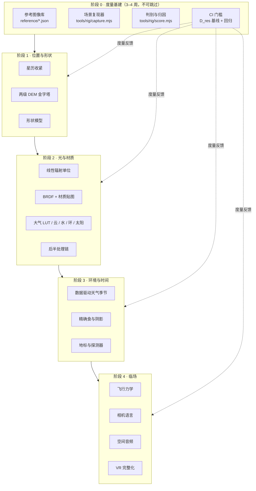

**依赖关系是硬的**：没有阶段 0，阶段 1–4 的每一步都无法回答"是否更真了"。这也是本文与仓库中已有的 `docs/sdlc/photorealism-roadmap.md` 最大的差别——那份路线图列出了 40 项改造，但没有一项给出"改完之后怎么证明它更真"。

---

## 阶段 0 · 真实度度量与判别测试台（3–4 周）

### 目标

把"像不像"变成一个 CI 里能跑的数字。

### 交付物

**0.1 参考图像库** `reference/scenes/*.json`

每个场景一条记录，字段：

```jsonc
{
  "id": "moon-apollo11-orbital-100km",
  "body": "moon",
  "camera": { "lat": 0.674, "lon": 23.473, "altKm": 100, "fovDeg": 58, "azimuth": 180 },
  "epochJD": 2460000.5,          // 复现影像的拍摄时刻（若有）
  "illumination": { "sunPhaseDeg": 12.4, "subsolarLat": 1.2, "subsolarLon": 23.1 },
  "reference": {
    "file": "reference/images/apollo11_lroc_100km.png",
    "source": "NASA/LRO LROC NAC", "date": "2011-09-06",
    "cameraModel": "...", "exposure": "...", "credit": "NASA/GSFC/Arizona State University"
  }
}
```

首批 60 个场景（覆盖三个域）：

| 域 | 场景 | 参考来源 |
|---|---|---|
| A 轨道 | 地球满相/半月相/新月相、木星、土星+环、天王星、海王星、火星、金星、水星、冥王星 | NASA/JPL Photojournal、Cassini、New Horizons、Juno、Messenger |
| B 低空 | 阿波罗 11/17 着陆区、好奇号/毅力号着陆区、奥林帕斯山、水手谷、珠峰、月球南极 | LROC NAC、HiRISE、CTX、ISS 摄影 |
| C 地表 | 阿波罗 11/17 月球表面、好奇号/毅力号全景、火星日落、月面地出 | NASA 实拍（含官方全景拼接） |

**0.2 场景复现器** `tools/rig/capture.mjs`

复用现有 Puppeteer 基建（`tools/release-catalog.mjs` 已有 70 个目的地的自动飞行），扩展为：

- 按 JSON 精确设定 `lat/lon/dist/FOV/azimuth/epochJD`
- 强制固定曝光（禁用自动曝光），以便与参考图的曝光条件对齐
- 输出 PNG + 同目录 `.json`（记录实际相机参数、`D_res`、渲染开销）
- 稳定性：同参数连拍 3 帧，逐像素差 > 阈值则判为"时序不稳定"并失败

**0.3 判别与归因** `tools/rig/score.mjs`

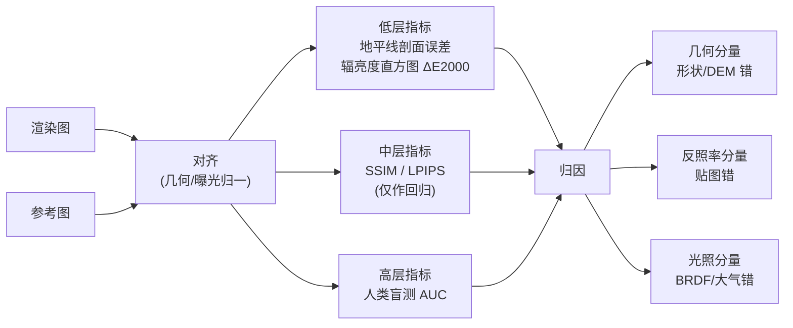

**归因方法**（这是本阶段最有技术含量的部分）：把渲染结果 `I_render` 与参考 `I_ref` 分解到三个正交分量——几何（地平线/轮廓位置差）、反照率（去光照后的色度比）、光照（同反照率下的辐亮度比）。这样每一处差异都能自动指向第 3 章里的具体缺口编号，而不是"看起来不太像"。

**0.4 CI 门槛** `.github/workflows/realism.yml`

- 每个场景记录：`D_res`、地平线误差、ΔE2000、SSIM、LPIPS
- 相对基线的**回归失败**（任一指标退步 > 5%）阻断合并
- 每季度重跑一次完整盲测，产出 AUC 报告

### 验收

- 60 个场景全部可一键复现，输出可复现（同参数连跑 3 次逐像素差 < 0.5%）
- 每个场景给出 `D_res` 数字，汇总成"真实度前沿"总表
- 至少完成一轮 30 人盲测，得到基线 AUC

### 工作量

3–4 周（参考图搜集与版权核对约占一半）。

---

## 阶段 1 · 位置与形状（"在哪里、什么形状"）

### 1.1 星历收紧（对应 A1–A17）

| 任务 | 做法 | 验收 |
|---|---|---|
| **修 ΔT**（A1，最高优先，1–2 天） | 用完整 Espenak & Meeus 分段多项式（−500 → 2005）+ IERS 实测表（1973 → 今）+ 2026 后外推曲线；`npm run verify` 时从 IERS 拉最新闰秒 | 1800/1900/1950/2000/2026 各年误差 ≤ 0.5 s |
| **修月球条目**（A3，半天） | 修正 `moonsData` 中 moon 的 `nDegPerDay`（30.47 → 27.32 天）与交点退行率（差 160 倍）；加断言防止再次回归 | 月球轨道法线与理论值一致 |
| **卫星精度与窗口**（A2、A6） | 加拉利略三星拉普拉斯共振相位锁定；每颗卫星改**多历元（≥6 个）拟合**并加高阶长期率；把 JPL 采样窗口从 16 个月扩到 10 年并按季度增量刷新；越界时 HUD 明确提示"当前为近似模型" | 窗口内 ≤ 0.01°；窗口外 ±1 年 ≤ 0.1° |
| 章动与岁差（A4） | IAU 2006/2000A 完整旋转链替换单个黄经岁差项 | 与 SOFA 比对 ≤ 1 mas |
| 光行时与光行差（A5） | 渲染取位时按 `t − d/c` 迭代 2 次（已有）；恒星加周年光行差；可选加太阳光线偏折 | 与 Horizons observer 模式比对 ≤ 1″ |
| 扁率（A7） | 地球/火星/水星/金星/冥王星与卫星渲染真实扁率，并同步修正地形、碰撞、拾取 | 地球极半径 6356.75 km |
| 卫星扩充（A8、A9） | 21 → 60+ 颗（土星系中型卫星、天卫全部、海卫主要成员、冥卫）；加天平动 | 清单 + 视觉验证 |
| 小天体（A10、A11） | 主带按直径排序取前 5 万颗 + NEA 全量 + 彗星全量；**统计点云改为真实轨道实例，随时间运动**；Ceres/Vesta/Pallas/Juno 升级为真实世界（形状模型 + 自转） | 抽查 50 颗 vs Horizons ≤ 0.01° |
| TNO 与彗星（A12、A13） | 补 `nodeDot/periDot`；彗星补非引力参数 A1/A2/A3；纳入星际天体 | ±10 年 ≤ 0.05° |
| 相对论/潮汐（A14，可选） | 水星近日点进动附加率；Phobos/月球潮汐长期率（仅教学展示开关） | 数值与理论值一致 |

### 1.2 两级 DEM 金字塔（对应 B1、B2 —— **单项收益最大**）

**问题**：全球均匀四叉树不可扩展。当前 L4 = 32 MB/天体；若按同一方案推到 L8（月球 LOLA 水平），需要 **8 GB/天体**。

**方案：全球骨架 + 区域补丁**

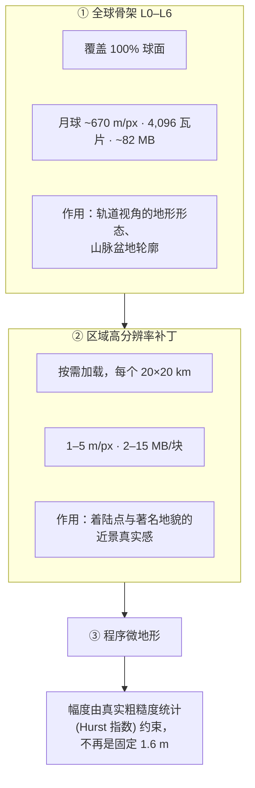

**容量估算（实测数字）**：

| 方案 | 月球 | 火星 | 地球 |
|---|---:|---:|---:|
| 现状（L4） | 41 MB | 41 MB | 41 MB |
| 全球骨架 L6（670 m/px） | ~82 MB | ~82 MB | ~82 MB |
| 单个 20 km 着陆区 @ 5 m/px | 7.6 MB | 7.6 MB | 7.6 MB |
| 单个 10 km 精细区 @ 1 m/px | 47 MB | 47 MB | 47 MB |

**建议配比**：全球骨架 L6（3 天体 ≈ 250 MB）+ 20 个着陆区 × 平均 5 MB ≈ 100 MB。**总计约 350 MB**，是现状 123 MB 的 3 倍，但换来全球地形分辨率提升 4 倍、着陆区提升 50–500 倍。

**数据源表**（按天体）：

| 天体 | 全球骨架源 | 分辨率 | 区域高分辨率源 |
|---|---|---|---|
| 月球 | LOLA (LRO) | 118 m/px | LROC NAC DTM、阿波罗着陆区专用产品 |
| 火星 | MOLA | 463 m/px | HiRISE DTM（1,200+ 处，1 m/px）、CTX DTM |
| 地球 | SRTM / ASTER GDEM | 30 m/px | 各地区 LiDAR / 摄影测量；海床用 GEBCO 450 m |
| 水星 | MESSENGER MLA + MDIS DTM | ~500 m/px 起 | USGS 局部 DTM |
| 金星 | Magellan 高度计 | ~1–5 km/px | （无更好数据，接受） |
| 冥王星 | New Horizons LORRI 立体 | ~1 km/px 局部 | 局部立体 DTM |
| 木卫二/木卫三/木卫四/木卫一 | Galileo + Juno 立体 | 局部 | USGS 可用 DTM |
| 土卫六 | Cassini RADAR SAR 高度计 | 局部 | （全球受限于大气，接受） |
| 土卫二/土卫一/… | Cassini ISS 立体 | 局部 | 少数 |

> **诚实说明**：金星全球只有 Magellan 的公里级高度计；土卫六全球被雾遮住。这些天体**不可能**达到月球地表级别的真实感，必须如实标注。这正是 4.1 节的分层原则。

### 1.3 形状模型（B6）

接入 PDS Small Bodies Node 的 **DSK / 三角板形状模型**：67P（Rosetta）、Bennu（OSIRIS-REx）、Itokawa（隼鸟）、Eros（NEAR）、Vesta/Ceres（Dawn）、Phobos/Deimos 等。渲染从"高度场球"改为**真实三角网格 + 碰撞网格**。

### 验收

- 月球/火星/地球全球地形 D_res ≤ 1,000 km（轨道尺度无破绽）
- 20 个着陆区 D_res ≤ 50 km（即 5 m/px 下在 50 km 内看不出）
- 至少 8 个小天体使用真实形状模型

### 工作量

3–4 个月（数据管线占绝大部分）。

---

## 阶段 2 · 光与材质（**视觉质变阶段**）

### 2.1 线性辐射单位（对应 C8、C11）

**现状是"看起来对"而不是"算得对"**：太阳强度 `uSunI = 13 * multiplier`（`builder.js:638`），曝光 `pow(dSunAU, 0.85)`，气巨 `interiorBoost` 到 `1+depth²*24`（`main.js:1176`），外太阳系 `I^0.55` 补偿。

**改造**：

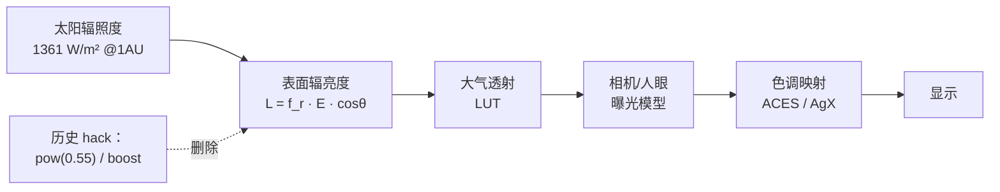

- 所有材质改为物理单位（W/m²/sr），渲染目标保持 HalfFloat
- 曝光改为**基于画面测光**（对数平均亮度 + 直方图），而非日心距离
- 删除全部 `pow(0.55)` / `interiorBoost` / `uGrade` 类 hack（改为在校准环节用 LUT 处理）
- 人眼暗适应用真实时间常数（暗适应数分钟、亮适应数秒）分阶段建模

**风险**：这一步会改变全场景观感，必须依赖阶段 0 的回归基线。

### 2.2 BRDF 与材质贴图（对应 C1、C2 —— **最大的单项收益**）

| 天体类型 | 目标 BRDF | 理由 |
|---|---|---|
| 无气天体（月、水星、木卫四、冥王星…） | **Hapke**（含冲日增亮、后向散射） | 月面满月增亮 40%+，是所有月球照片最显著的特征 |
| 有风化层天体（火星、地球裸地） | Hapke 或 Oren-Nayar | 粗糙漫反射 |
| 气巨云顶 | Lambert + 各向异性云带 | 云顶接近朗伯 |
| 冰面/水面 | GGX + Fresnel + 次表面近似 | 镜面反射 |
| 环 | 粒子相函数积分（预计算 LUT） | 逆光/顺光外观完全不同 |

**材质贴图管线**（当前 0 张）：

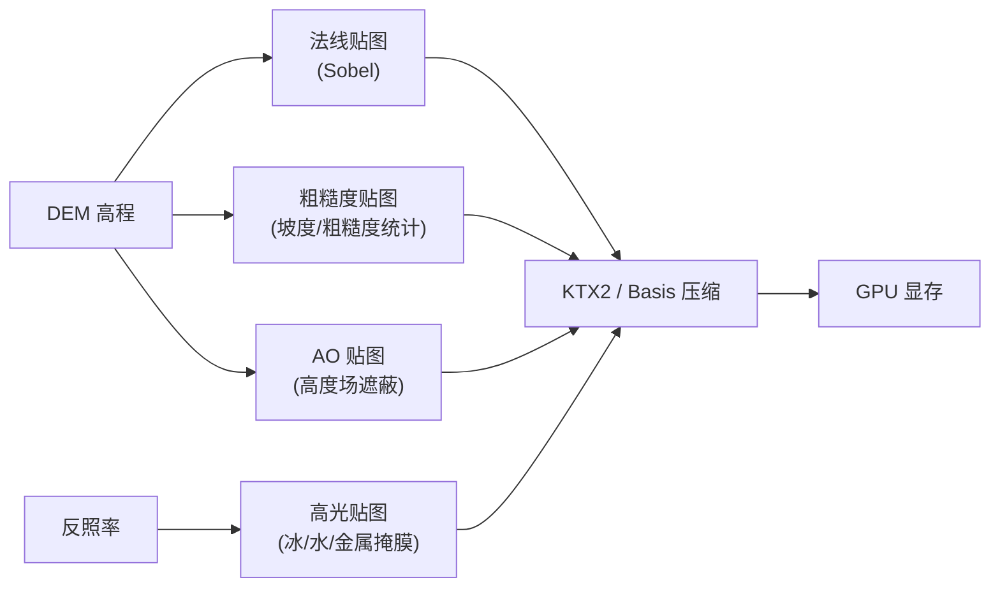

**派生而非购买**：法线、粗糙度、AO 都可以从已有的 DEM 用脚本生成，成本远低于寻找现成贴图。

### 2.3 大气（C3）、云（C4）、水（C5）、环（B7）、太阳（C6）

| 子系统 | 方案 | 关键参数 |
|---|---|---|
| **大气多重散射** | 预计算 LUT：透射率 LUT（2D）+ 多次散射 LUT（3D/4D，Bruneton 式）。离线为每颗行星生成，运行时三次采样 | 地球标高 8 km、大气顶 100 km（当前只有 60 km，`bodies.js:49`） |
| **臭氧层** | 在透射率 LUT 中加 O₃ 吸收截面（Chapman 剖面，峰值 25 km） | 暮光蓝色带、金星带的关键 |
| **体积云** | 低层：有限步数 raymarch（16–24 步）+ 3D 噪声 + 预计算光照；高层：卷云贴图。云投影到地表 | 需配合时域重用才能跑得动 |
| **水面** | FFT 或 Gerstner 浪谱 + SSR 反射 + 屏幕空间折射 + 次表面散射 + 泡沫 | 当前只有三条噪声法线 |
| **环系** | 光学深度贴图（真实 Cassini 数据）+ 粒子相函数 LUT + 环-环自阴影 + 稀疏粒子叠加；补建木星环 / 海王星环 | 土星环当前是零厚度平面 |
| **太阳** | 五阶多项式临边昏暗（真实光球）；日冕改 3D 结构（或至少让它在非日食时按视张角可见）；加日珥、色球红边；加太阳风粒子 | 当前日冕除日全食外不可见 |

### 2.4 后半处理链（C7）

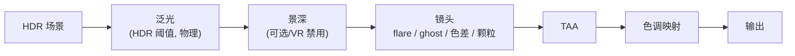

**注意"两套光学"分离**：人眼与相机是不同的成像系统。

- **人眼模式**（默认）：无镜头光晕、无鬼影，有眩光扩散（用 PSF 卷积近似）、有暗适应
- **相机模式**（可切换）：镜头光晕、鬼影、色差、颗粒、光圈衍射星芒

当前 `main.js:92` 明确禁用了泛光，理由是"非物理"。**这个决定是对的但不是最优的**——正确的做法不是禁用，而是改成"HDR 阈值驱动的物理泛光"，它模拟的是眼内/镜头内的光散射，本身就是物理的。

### 验收

- 阶段 0 的 60 个场景，AUC 从基线下降到 ≤ 0.70（阶段 2 完成时）
- 逐场景归因报告中,"光照分量"误差显著下降（这是本阶段的核心 KPI）
- 全景性能不回退（High 档仍 60 FPS）

### 工作量

5–7 个月，可分 4 个可独立发布的子批次：

| 批次 | 内容 | 收益 |
|---|---|---|
| 2-A | 线性辐射 + 物理泛光 + 材质贴图管线 | 立刻可见 |
| 2-B | Hapke BRDF（无气天体优先）+ 大气 LUT + 臭氧 | 月面/地球黄昏质变 |
| 2-C | 体积云 + 水面 + 环系 | 地球/土星质变 |
| 2-D | 太阳 + 后半处理链 | 收口 |

---

## 阶段 3 · 环境与时间（"此刻对不对"）

| 任务 | 做法 | 数据源 |
|---|---|---|
| 地球云（D1） | 双层结构 + 按**真实日期**加载云图（历史时相可用 MODIS/GOES 存档），或程序云 + 真实气候平均约束 | NASA GIBS / MODIS |
| 火星尘暴（D1） | 按真实 Ls + 尘暴指数（TES/MCS 光学厚度记录）驱动 | NASA PDS |
| 极冠与海冰（D5） | 火星 CO₂ 极冠按真实 Ls 退缩曲线；地球海冰用 NSIDC 月平均 | NSIDC / MOLA |
| 太阳活动（D4） | 黑子按真实太阳周相位与蝴蝶图分布；日冕形态随活动周变化 | SDO / SILSO 黑子数 |
| 精确食（D2、D3） | 贝塞尔根数法替代 alignment 阈值；阴影改为在接收体 shader 内做"遮挡体列表"光照衰减（真正变暗 + 红化）；覆盖所有行星-卫星组合 | Five Millennium Canon of Solar Eclipses |
| 黄道光/气辉（C13） | 按 DIRBE 模型的黄道光楔形亮度；地球夜侧气辉薄壳 | COBE/DIRBE |
| 地标与探测器（待补） | 阿波罗/Apollo 月面遗迹、好奇号/毅力号轨迹、旅行者/新视野/朱诺/卡西尼真实 3D 模型 + 真实轨迹 | NASA PDS / JPL Horizons |

### 工作量

3–4 个月。

---

## 阶段 4 · 临场（"我在不在"）

### 4.1 飞行力学（E1–E4、E7）—— **这是"1:1 模拟"的题眼**

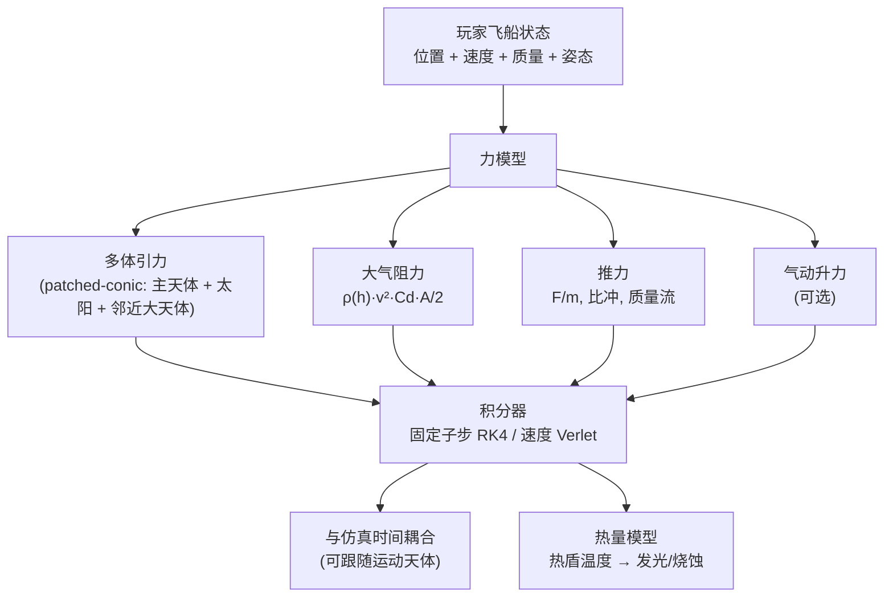

**分级落地**（避免一次重写破坏现有手感）：

| 级别 | 内容 | 默认 |
|---|---|---|
| L1 | 加入引力 + 固定子步积分，保留现有速度控制 | 先做 |
| L2 | 加入大气阻力 + 气动加热可视化（再入发光） | 再做 |
| L3 | 质量/推力/比冲/燃料/Δv 预算 | 教育模式开关 |
| L4 | 与真实地形碰撞（用 DEM 高度场做球-高度场碰撞，成本低） | 必做 |
| L5 | 保留"街机手感"作为可切换模式（现有一阶滞后模型） | 默认开启，拟真可选 |

**关键洞察**：**L1 与 L4 是性价比最高的两项**。有了 L1，"停在地球静止轨道看地球自转"这种体验才成立；有了 L4，"贴着峡谷飞"才安全。这两项加起来不到 L3 的 1/3 工作量。

### 4.2 相机语言（E8）

极小的代码量，极大的沉浸收益：

- 行走：脚步驱动头部晃动（与音频同步）
- 着陆：冲击震动 + FOV 轻微压缩
- 加速：FOV 轻微扩张 + 轻微抖动
- 高速再入：高频抖动 + 屏幕边缘暗角
- 安静时：呼吸幅度

### 4.3 空间音频（E9、E10）

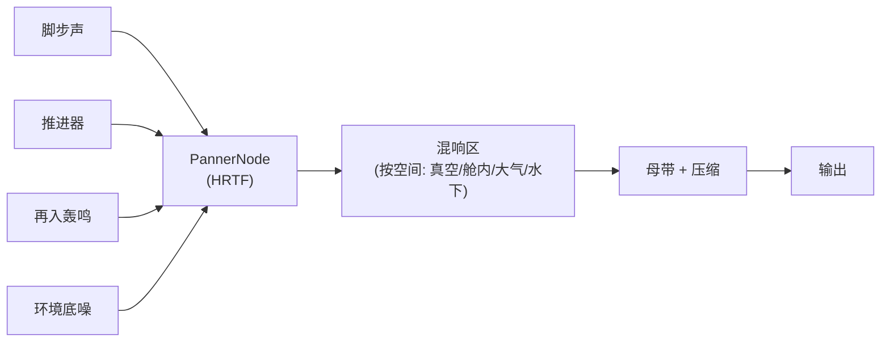

- 从 4 层单声道升级为真正的空间音频（`PannerNode` + HRTF + 多普勒）
- 增加：推进器、RCS、再入、UI、每个天体的环境底噪
- **真空的处理**：物理上真空中没有声音，但真实航天器内部有结构传导声。正确做法是"舱内/宇航服内"听到声音，"舱外"只有无线电。这是教育价值也是沉浸感。

### 4.4 VR 完整化（E11）

| 缺口 | 方案 |
|---|---|
| 飞/走模式不能移动 | 接入移动；传送用抛物线弧 + 落地预览 + 暗角隧道防眩晕 |
| 控制器拾取是空桩 | `_raycastBody` 实现真实 raycast（射线长度从 100 km 改为可配置跨度） |
| post 链路被跳过 | VR 内也走 HDR + 色调映射（可用更省的 MSAA 路径） |
| 无触觉 | `XRInputSource.gamepad.hapticActuators` |
| 无舒适选项 | 瞬移/平滑移动切换、snap turn、暗角、坐姿模式 |
| 无 UI | 世界空间面板（不是 DOM） |
| 无真机验证 | Quest 3 / PICO / Vision Pro 至少各一台 |

### 工作量

3–5 个月。

---

## 阶段 5 · 收口

| 任务 | 内容 |
|---|---|
| 三档画质 + 带宽感知（F4） | High / Medium / Low；`navigator.connection` + `deviceMemory` 参与分档；VR 内独立预算 |
| 引擎层测试（F5） | 相机/飞船/时间/质量分档的单元与回归测试 |
| 渲染精度（F6） | 层级浮动原点（恒星系 → 行星系 → 地形三级）；远端实体改双精度相对量 |
| 可访问性（E18） | 恢复缩放、`:focus-visible`、标签/结果可 Tab、`aria-live` 播报导航与旁白、色彩盲模式、全域 `prefers-reduced-motion`、可关闭晃动 |
| 内容与多语言（E17、E20） | 结构化课程（替代随机知识卡）、新手引导、教师工具与书签 UI 接通、非中英语言的名称与描述补全（当前 es/ja/fr/de/ru 是"英文名 + 中文描述"混合） |
| UI 可用性（E13–E16、E21、E22） | 电影/纯净模式；旁白字幕层；标签亮度分级与"仅名称"模式；5400 颗小天体与地标接入搜索/标签/前往；HUD 改脏检查、标签改池化 + 缓存 DOM 引用 |
| 离线与安装（E19） | Service Worker + 分层预缓存（首屏 / 按需 / 离线包），兑现教师工具的"U 盘离线"承诺 |
| 电影模式 | 一键隐藏全部 UI（**建议立刻做，半天**） |

### 工作量

2–3 个月。

---

# 第 6 章 数据与资产管线

## 6.1 数据源总表

| 类别 | 来源 | 许可 | 备注 |
|---|---|---|---|
| 行星/卫星/小天体星历 | JPL Horizons / SBDB | 公有领域 | 已有管线 |
| 月球地形 | LRO LOLA（118 m/px）、LROC NAC DTM | 公有领域 | USGS Astrogeology |
| 火星地形 | MOLA（463 m）、HiRISE DTM（1 m，1,200+ 处）、CTX DTM | 公有领域 | PDS |
| 地球地形 | SRTM（30 m）、ASTER GDEM、GEBCO 海床（450 m） | 公有领域 | |
| 行星影像镶嵌 | USGS Astrogeology 官方镶嵌图 | 公有领域 | **替换当前的 Solar System Scope 二次合成** |
| 无气天体反照率 | LROC WAC、MDIS、Cassini ISS | 公有领域 | |
| 恒星表 | Gaia DR3（G ≲ 12 约 10⁶ 量级）+ HYG/AT-HYG 合并表 | CC-BY-SA / 公有领域 | 含自行、视差、BP-RP 色指数 |
| 银河背景 | ESO / Gaia 全天合成图 | CC-BY | 替换当前 530 KB JPEG |
| 小天体形状模型 | PDS SBN DSK / 三角板模型 | 公有领域 | 67P、Bennu、Itokawa、Eros… |
| 云 / 天气 | NASA GIBS（MODIS/VIIRS 时相）、NSIDC 海冰 | 公有领域 | |
| 环系光学深度 | Cassini UVIS/VIMS 环光学深度剖面 | 公有领域 | |
| 太阳 | SDO AIA 合成、SILSO 黑子数 | 公有领域 | |

## 6.2 资产管线架构

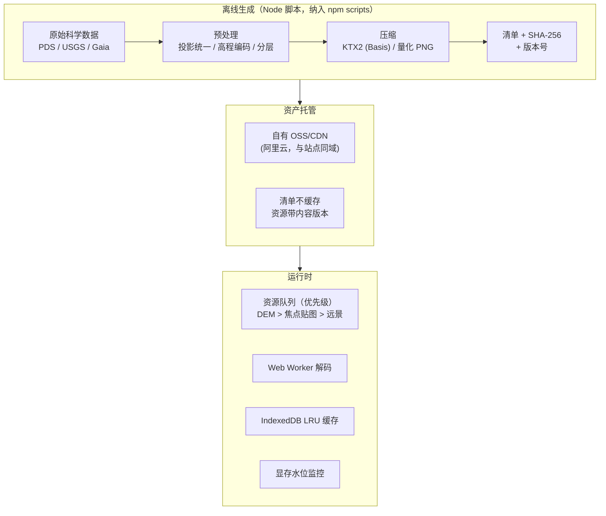

**关键设计**：

1. **一切资产离线预处理**，运行时只做解码与上传（当前 `fetch-dem.mjs` 已是这个模式，要扩展）
2. **清单版本化**，资源带内容哈希；清单不缓存（`RELEASE_READINESS.md:85` 已有）
3. **DEM 优先级高于贴图**（`demTiles.js:199` 已有 `priority 100+`）
4. **显存水位监控**（当前只有张数上限，没有字节上限——`demTiles.js:146` LRU 是按张数）

## 6.3 许可与署名台账

当前 `THIRD_PARTY_NOTICES.md` 只有 Astronomia 一项；`README.md:194` 只有一行贴图来源。**必须建立逐资产的来源台账**：

```jsonc
// reference/ATTRIBUTION.json
{
  "textures/earth_day.ktx2": {
    "source": "NASA Visible Earth / USGS",
    "derivedFrom": "MODIS 2014 composite",
    "license": "Public Domain",
    "url": "...", "retrieved": "2026-11-01"
  }
}
```

并在页脚生成"数据来源"页面。NASA/USGS/ESA 数据大多为公有领域或 CC-BY，**署名成本很低，法律风险却不低**。

---

# 第 7 章 验收体系（KPI 表）

## 7.1 分域 KPI

| 域 | 指标 | 当前 | 阶段 1 后 | 阶段 2 后 | 终局目标 | 测量方法 |
|---|---|---|---|---|---|---|
| 星历 | 行星 vs JPL | ≤0.074° | ≤0.01° | — | ≤1×10⁻⁴° | `npm run verify` |
| 星历 | ΔT 历史误差 | **89 s @1900** | ≤0.5 s | — | ≤0.5 s | 单元测试 vs IERS |
| 星历 | 卫星 ±1 年 vs JPL | 2–4° | ≤0.1° | ≤0.05° | ≤0.01° | 新增测试 |
| 形状 | 月球地形 D_res（全球） | 9,200 km | 1,000 km | 1,000 km | 500 km | 脚本计算 |
| 形状 | 着陆区地形 D_res | 9,200 km | **50 km** | 20 km | 10 km | 脚本计算 |
| 形状 | 有真实地形天体数 | 3 | 12 | 20 | 25+ | 清单 |
| 形状 | 真实形状模型小天体数 | 0 | 8 | 15 | 30+ | 清单 |
| 光 | BRDF | Lambert | Hapke(无气) | 全类型 | 全类型 | 代码审查 + 盲测归因 |
| 光 | 材质贴图覆盖率 | **0%** | 60% | 100% | 100% | 清单 |
| 光 | 大气 | 单次散射 | LUT+臭氧 | +云 | +气溶胶剖面 | 盲测归因 |
| 光 | 后期链 | 仅 ACES | +泛光 | +景深/TAA | +镜头 | 代码审查 |
| 光 | 星空真实星数 | 132 | 10⁵ | 10⁶ | 10⁶ | 清单 |
| 环境 | 天气按日期驱动天体数 | 0 | 3 | 6 | 8 | 清单 |
| 环境 | 精确食覆盖 | 4 组三元组 | 全行星-卫星 | 全系统 | 全系统 | 事件比对 |
| 临场 | 玩家引力 | **无** | 有 | +阻力 | +Δv 预算 | 代码审查 + 任务演示 |
| 临场 | 真实碰撞 | 无 | 地形高度场 | 网格 | 网格 | 任务演示 |
| 临场 | 空间音频 | 单声道 | HRTF | +混响区 | +多普勒 | 代码审查 |
| 临场 | VR 可完成的任务 | 只能缩放 | 可移动+拾取 | 全流程 | 全流程 | 真机测试 |
| 综合 | **盲测 AUC（60 场景）** | 未测 | — | ≤0.70 | **≤0.60** | 盲测平台 |

## 7.2 回归门槛（CI 强制）

1. `npm test` 136 项全通过（已有）
2. 真实度场景集：无指标退步 > 5%
3. 性能：High 档地表 ≥ 55 FPS、Low 档 ≥ 45 FPS、移动 ≥ 30 FPS
4. 时序稳定：同参数连拍 3 帧逐像素差 < 0.5%（当前**完全没有这项检查**，而 LOD 跳变/贴图 pop 正是最容易被察觉的"假"）
5. 无新增未捕获异常/资源失败（已有）

---

# 第 8 章 里程碑与排序

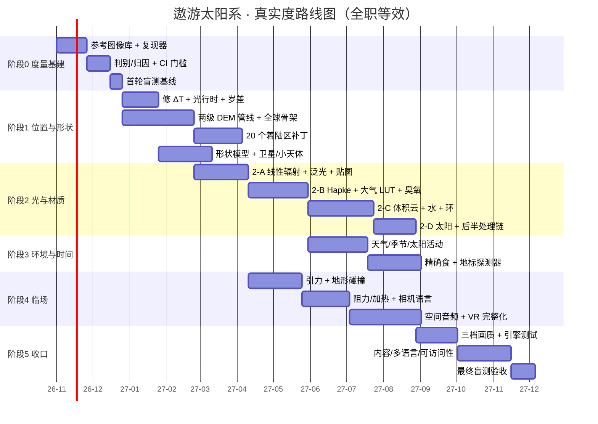

## 8.1 如果只有 3 个月：最高性价比组合

按"单位工作量带来的真实度提升"排序，前 5 名是：

**先说五个"一两天就能做完、但用户立刻就感觉得到"的速赢**（建议本周就做）：

| 速赢 | 工作量 | 效果 |
|---|---|---|
| **E13 电影/纯净模式**（一键隐藏全部 UI） | 半天 | 截图、录屏、演示、VR 立刻可用 |
| **E15 修旁白裁切**（给 `#hud-tip` 加 `overflow` + 换行 + 字幕层） | 半天 | 导览从"读不全"变成可用 |
| **A1 修 ΔT 分段多项式** | 1–2 天 | 修掉 1800 年 +208 s 的严重错误 |
| **A3 修月球条目**（周期 +11.5%、交点率差 160 倍） | 半天 | 潮汐锁定姿态回归正确 |
| **E14 接通导览 `action`** | 1 天 | 三条导览的旁白终于和画面对上 |

**再做五项结构性投入（约 3 个月）**：

| 排名 | 任务 | 工作量 | 为什么 |
|---|---|---|---|
| 1 | **阶段 0 度量台** | 3–4 周 | 没有它，后面全是在猜 |
| 2 | **C2 材质贴图管线（从 DEM 派生法线/粗糙度）** | 2 周 | 从"0 张"到"全有"，地表质感立刻质变 |
| 3 | **B1 DEM 推到 L6 + 3 个着陆区补丁** | 5 周 | "走到地面就露馅"的直接解法 |
| 4 | **C7 物理泛光 + C1 无气天体 Hapke** | 3 周 | 太阳和月亮是辨识度最高的两个天体 |
| 5 | **A6 星历窗口扩到 10 年** | 3 周 | 拆掉"2027-10-01 之后卫星错 6°"的定时炸弹 |

**合计约 3.5 个月**，能让"最容易被认出是假的"几个场景显著改善，并消除一个会在 2027 年 10 月自动触发的严重退化。

---

# 第 9 章 风险、取舍与"不做清单"

## 9.1 风险

| 风险 | 影响 | 对策 |
|---|---|---|
| 资产体积爆炸 | 部署与首屏不可接受 | 两级金字塔 + KTX2 + 按需流式；离线预计算；显存字节水位监控 |
| 性能回退 | 新效果跑不动 | 每批次必须过性能门槛；中端设备优先 |
| 亮度体系统一改动导致全场景观感变化 | 现有视觉回归全废 | 必须先在阶段 0 建立基线；分场景评审 |
| 数据许可 | 法律风险 | 逐资产台账 + 页脚来源页 |
| 单人维护 | 进度延迟 | 严格分批可独立发布；每批都有可演示结果 |
| "无法区分"永远无法宣布 | 目标感丧失 | 采用第 4.4 节的可执行目标（场景集 + 盲测阈值），可宣布、可递增 |

## 9.2 明确不做（省下大量时间）

| 不做 | 为什么 | 替代 |
|---|---|---|
| N 体积分真实轨道 | 浏览器算力不够，且"目视不可区分"不需要 | 高阶层数解析星历 + 定期刷新真实数据 |
| MHD 日球层 | 同上 | IBEX/旅行者数据拟合的形状 |
| 完整 ELP 全级数 | 收益递减 | 截断到视位置误差 < 1″ |
| 实时路径追踪全局光照 | 算力不够 | 预计算 LUT + 解析互照近似 |
| 真实流体云模拟 | 算力不够 | 体积 raymarch + 预计算光照 + 时域重用 |
| 10⁹ 环系粒子 | 算力不够 | 光学深度贴图 + 稀疏粒子 |
| 全 130 万小行星 | 无意义 | 按视星等/直径筛选 + 统计补齐（明确标注） |

## 9.3 关于"诚实标注"

这是本方案的一个核心主张：**一个宣称"无法区分真实与模拟"的项目，必须首先能够诚实指出自己哪里是假的。**

建议在 UI 中加入"证据等级"图层（可切换）：

- 🟢 实测影像覆盖（LROC/HiRISE/Cassini 等）
- 🟡 低分辨率实测（MOLA 全球、Magellan）
- 🔴 推断／程序化（金星细节、土卫六地表、奥尔特云）

这既满足科研诚实性，本身也是极好的科普内容——它会告诉用户"人类对哪里了解得多，对哪里几乎一无所知"。

---

# 第 10 章 结论

## 10.1 总体判断

| 问题 | 回答 |
|---|---|
| 项目现在有多真实？ | 星历层已达工程可信；渲染层是"高保真科普级"；交互层是"相机漫游"而非"模拟" |
| 距离"无法区分"还有多远？ | 图像级差距约 2 个数量级（主要体现在 BRDF、材质、大气、后期）；物理级约 1 个数量级；身心级几乎是空白 |
| 最该先做什么？ | **阶段 0 度量台**。其次是三个"小而致命"的修复：ΔT 表、DEM 层级夹断、材质贴图为零 |
| 能做到吗？ | 图像级"在声明场景集上通过盲测"——**能做到**，约需 12–18 个月全职。物理级"处处无法区分"——**做不到**，任何浏览器项目都做不到 |
| 需要多少时间？ | 全量 17–24 个月全职等效；当前节奏 3–4 年 |

## 10.2 三条最重要的建议

**第一，先把尺子造出来。**
项目已经有 130+ 个探针脚本、282 组对照截图、136 项测试——工程纪律非常好。但这些全部在回答"它坏了吗"，没有一个在回答"它像吗"。阶段 0 的 3–4 周投入，会决定后面 20 个月的每一步是否走在正确方向上。这是本文最重要的一条建议。

**第二，先修五个"小而致命"的地方。** 它们各自只需半天到两天，但每一个都在拖着整体真实度：

| 位置 | 问题 | 修完之后 |
|---|---|---|
| `time.js:45-47` | ΔT 历史多项式用错（1800 年偏 **208 s**，地球自转错 0.87°） | "时间机器"这个核心卖点才成立 |
| `moonsData.generated.js` 的 moon 条目 | 周期 30.47 天 vs 真值 27.32 天；交点退行率差 **160 倍** | 潮汐锁定朝向回归正确 |
| `demTiles.js:46,55,64` | `maxLevel: 4` 静默夹断了 `terrain.js:876` 请求的 L8 | 月面从 2.67 km/px 起跳有了空间 |
| 全仓库 | **0 张法线/粗糙度贴图** | 地表从"贴照片的球"变成"有质感的地" |
| `public/data/ephemeris/manifest.json` | 采样窗口只到 **2027-10-01**，之后卫星错 2–6° | 拆掉一颗定时炸弹 |

前四项加起来不到一周，第五项约三周。**没有一项需要新的算法研究，全部是修错与补数据。**

**第三，把目标从"完美"改成"可宣布"。**
"无法区分真实与模拟"作为一个绝对目标，永远无法被证明达成——这会让项目永远停在"还不够"的状态，也会让所有对外表述都处于过度承诺的风险中。改成 **"在声明场景集 S 上，人类盲测 AUC ≤ 0.60"**，就变成一个可以逐步推进、可以对外宣布、可以被第三方复核的目标。而且它更诚实，也更有说服力。

## 10.3 最后

这个项目已经完成了最难的部分——**真实的尺度、真实的星历、真实的数据、真实的无缝着陆**。这些是"有没有"的问题，而剩下的绝大部分是"够不够"的问题。

"够不够"是工程问题，工程问题是可以靠度量和迭代解决的。

---

# 附录 A · 缺口全量对照表

> 完整清单见第 3 章。此处给出编号索引，便于跟踪。

| 编号 | 一句话 | 级别 | 阶段 |
|---|---|---|---|
| A1 | ΔT 表冻结 + 1972 前多项式错误（1900 年 +89 s，1800 年 +208 s） | P0 | 1 |
| A2 | 卫星解析回退一年内退化到 1.2–6.0°（文档写 ≤0.22°） | P0 | 1 |
| A3 | `moonsData` 月球条目本身错误（周期 +11.5%、交点率差 160 倍），影响潮汐锁定姿态 | P0 | 1 |
| A4 | 无章动（±17.2″，比行星误差大 7 倍） | P1 | 1 |
| A5 | 无观测者光行差/光线偏折/Shapiro | P1 | 1 |
| A6 | JPL 采样窗口仅 16 个月，窗外静默换模型 | P0 | 1 |
| A7 | 地球/火星/水星/金星/冥王星与全部卫星忽略扁率 | P1 | 1 |
| A8 | 卫星仅 21/890 颗（土星 6/60+、天王星 5/27、海王星 1/16、冥王星 0/4） | P1 | 1 |
| A9 | 潮汐锁定天体全部无天平动 | P1 | 1 |
| A10 | 小天体 5412 颗共用单历元、纯二体；Ceres/Vesta 不是"世界" | P1 | 1 |
| A11 | 小行星带/柯伊伯带/奥尔特云为静态点云，永不移动 | P1 | 1 |
| A12 | 仅 4 颗彗星；哈雷根数是 1976 年的、无非引力项 | P2 | 1 |
| A13 | 28 颗 TNO 的交点/近日点速率全部为 0 | P2 | 1 |
| A14 | 无 N 体/相对论/潮汐/J2 动力学 | P2 | 1 |
| A15 | 冥王星回退 Standish，精度差 12 倍 | P2 | 1 |
| A16 | 未实现 JPL Table 2b，"±3000 年"缺支撑 | P2 | 1 |
| A17 | 死代码与过期注释（`moonGeocentricFast` 等）误导维护者 | P2 | 1 |
| B1 | **DEM 夹在 L4（请求 L8）** | P0 | 1 |
| B2 | ~28 个天体无地形 | P0 | 1 |
| B3 | 亚 DEM 细节固定 1.6 m | P1 | 1 |
| B4 | 撞击坑为噪声等值线 | P1 | 1 |
| B5 | 岩石为变形二十面体 | P2 | 1 |
| B6 | 小天体全是球 | P1 | 1 |
| B7 | 环零厚度；木星/海王星无环 | P0 | 2 |
| C1 | **纯 Lambert** | P0 | 2 |
| C2 | **零材质贴图** | P0 | 2 |
| C3 | 无多重散射/臭氧 | P0 | 2 |
| C4 | 云是贴图球壳 | P0 | 2 |
| C5 | 水面无反射/折射 | P0 | 2 |
| C6 | 太阳无日冕(平时)/日珥/光晕 | P0 | 2 |
| C7 | **无后期处理** | P0 | 2 |
| C8 | 曝光不测光 | P1 | 2 |
| C9 | 气巨细节是噪声 | P1 | 2 |
| C10 | 无行星互照 | P1 | 2 |
| C11 | 显示 hack（I^0.55 / interiorBoost） | P1 | 2 |
| C12 | 星空 132 真星 + 随机点 | P0 | 2 |
| C13 | 无黄道光/气辉 | P2 | 3 |
| C14 | 彗尾简化；仅 4 颗彗星 | P2 | 3 |
| D1 | 无数据驱动天气 | P0 | 3 |
| D2 | 食用锥体叠加 | P1 | 3 |
| D3 | 食搜索仅 4 组三元组 | P1 | 3 |
| D4 | 无太阳活动周期 | P1 | 3 |
| D5 | 无季节视觉 | P1 | 3 |
| D6 | 无夜面气辉/灯光时相 | P2 | 3 |
| D7 | 高倍速时域混叠（10 年/秒 = 61 天/帧） | P1 | 5 |
| E1 | **玩家无引力** | P0 | 4 |
| E2 | 无阻力/再入 | P0 | 4 |
| E3 | 无质量/推力/Δv | P0 | 4 |
| E4 | **碰撞仅最近天体一个球** | P0 | 4 |
| E5 | 行走无坡度限制；DEM 更新传送玩家 | P1 | 4 |
| E6 | 水下浮力是常数 | P1 | 4 |
| E7 | 玩家物理与仿真时间解耦 | P1 | 4 |
| E8 | **无相机语言** | P0 | 4 |
| E9 | **音频全单声道** | P0 | 4 |
| E10 | 无引擎/UI 音效；音量不可达 | P1 | 4 |
| E11 | VR 不能移动/无触觉/无 post | P0 | 4 |
| E12 | 无真机验证 | P1 | 5 |
| E13 | **无电影/纯净模式**（半天可做） | P0 | 5 |
| E14 | 导览 `action` 字段从未执行，旁白与画面不符 | P0 | 5 |
| E15 | 导览旁白被 CSS `nowrap` 裁掉 | P0 | 5 |
| E16 | 标签全部带距离数字，无亮度分级 | P1 | 5 |
| E17 | 无新手引导 | P1 | 5 |
| E18 | 可访问性基本缺失 | P1 | 5 |
| E19 | 有 PWA 清单但无 Service Worker | P1 | 5 |
| E20 | 教师工具/书签/TTS 参数无 UI 入口 | P2 | 5 |
| E21 | 5412 颗真实小天体与地标不可搜索/不显示/不能去 | P1 | 5 |
| E22 | 每帧 3× `innerHTML` + 199 标签分配 | P1 | 5 |
| F1 | **无真实度度量** | P0 | 0 |
| F2 | 贴图是二次合成 | P1 | 1 |
| F2b | 31 个天体中只有 18 个有贴图 | P0 | 1 |
| F2c | 28 TNO + 4 彗星无贴图 | P1 | 1 |
| F2d | `newhorizons.bin` 与 `SPACECRAFT_TIMELINES` 是死资源 | P2 | 1 |
| F3 | 无观测来源台账 | P1 | 0 |
| F4 | 仅两档画质；无带宽感知 | P1 | 5 |
| F5 | 引擎层零测试 | P1 | 5 |
| F6 | 远端实体 fp32 位置精度 | P1 | 5 |
| F7 | 产物 224 MB | P2 | 5 |

## A.1 各阶段缺口计数

| 阶段 | P0 | P1 | P2 | 合计 |
|---|---:|---:|---:|---:|
| 0 度量 | 1 | 1 | 0 | 2 |
| 1 位置与形状 | 4 | 9 | 5 | 18 |
| 2 光与材质 | 8 | 4 | 0 | 12 |
| 3 环境与时间 | 1 | 3 | 3 | 7 |
| 4 临场 | 5 | 3 | 0 | 8 |
| 5 收口 | 3 | 8 | 1 | 12 |
| **合计** | **22** | **28** | **9** | **59** |

---

# 附录 B · 术语

| 术语 | 含义 |
|---|---|
| **D_res** | 可分辨距离。表面采样间距 ÷ 人眼角分辨率。比它更近就开始露馅 |
| **真实度前沿** | 所有天体的 D_res 构成的边界。这条线以内的区域是"可分辨的假" |
| **盲测 AUC** | 受试者区分"真实/合成"的能力。0.5 = 完全无法区分，1.0 = 一眼看穿 |
| **BRDF / Hapke** | 双向反射分布函数 / 其在无气天体风化层上的物理模型（含冲日增亮） |
| **LUT** | 查找表。把昂贵的物理积分离线预计算成纹理，运行时三次采样 |
| **两级 DEM 金字塔** | 全球低分辨率骨架 + 局部高分辨率补丁。替代不可扩展的全球均匀四叉树 |
| **时效性（时序伪影）** | LOD 跳变、贴图 pop、光照闪烁等"动起来才暴露"的假 |
| **证据等级** | 标注某区域是实测/低分辨率实测/推断 的图层 |

---

# 附录 C · 关键数字的复现方法

本文中的关键数字都可以在仓库里复现：

```bash
# 1) 单元测试现状
npm test                                   # 136/136

# 2) ΔT 历史误差（第 3 章 A1）
node -e "import('./src/astro/time.js').then(m=>{const d=m.dateToJD(new Date('1900-01-01T00:00:00Z'));console.log(m.deltaT(d))})"
# → 86.59（真值 −2.79，误差 89.4 s）

# 3) DEM 层级被夹断（第 3 章 B1）
grep -n "maxLevel" src/scene/demTiles.js   # → 46/55/64 均为 4
sed -n '875,884p' src/scene/terrain.js     # → 请求到 L8

# 4) 零材质贴图（第 3 章 C2）
grep -rn "normalMap\|roughnessMap\|envMap\|MeshPhysicalMaterial" src/   # → 无输出

# 5) 纯 Lambert（第 3 章 C1）
sed -n '303p' src/scene/planetMaterial.js

# 6) 资产清单
ls -la public/textures/ ; find public/dem -type f | wc -l
```

---

*本文档为分析产物，未对仓库做任何代码改动。*
